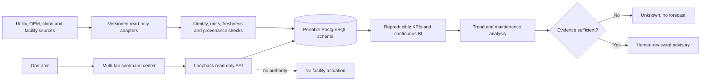

# Data Center Commander


**An open, operator-centered system for governing the full data-center lifecycle—from utility boundary to useful compute.**

[](https://github.com/AAH20/data-center-commander/actions/workflows/ci.yml)
[](LICENSE)

> One command view for facilities, energy, capacity, maintenance, economics,
> analytics, and evidence—with read-only integrations and explicit safety
> boundaries.

**Status:** local decision-support prototype. Vendor adapters, validated
forecasts, production IAM, and facility control are not delivered.

---

## Table of Contents

- [Architecture](#architecture)
- [Product Contract](#product-contract)
- [Feature Overview](#feature-overview)
- [Quick Start](#quick-start)
- [API Reference](#api-reference)
- [Database Schema](#database-schema)
- [Adapters](#adapters)
- [Economics Engine](#economics-engine)
- [Forecasting](#forecasting)
- [Quality & Validation](#quality--validation)
- [Security & Tenant Isolation](#security--tenant-isolation)
- [Provenance & Lineage](#provenance--lineage)
- [Observability](#observability)
- [Synthetic Demo](#synthetic-demo)
- [Standalone Layout](#standalone-layout)
- [Migrations](#migrations)
- [Testing](#testing)
- [Roadmap](#roadmap)
- [Safety and Authority Boundary](#safety-and-authority-boundary)
- [Screenshots](#screenshots)
- [License](#license)

---

## Architecture

Data moves from authorized sources through validation before it reaches
operator views and analytics. Recommendations remain advisory.



**Explore:** [full architecture](docs/ARCHITECTURE.md) ·
[lifecycle operations](docs/LIFECYCLE_OPERATIONS.md) ·
[integrations](docs/INTEGRATIONS.md) ·
[data model and KPIs](docs/DATA_MODEL_AND_KPIS.md)

Data Center Commander is a standalone, vendor-neutral operations and decision-support project. It joins facility, energy, environmental, asset, workload, capacity, maintenance, incident, change, and evidence data under one tenant-scoped operational model. It is not a BMS, EPMS, CMMS, hypervisor, scheduler, or safety controller; those systems remain authoritative for their domains.

---

## Product Contract

- Energy-to-compute is measured with explicit meter boundaries, aligned intervals, units, quality, source lineage, and allocation uncertainty.
- Every KPI is reproducible from named source observations and a versioned calculation definition; missing inputs produce `unknown`, not zero.
- All integrations begin read-only. Every connector declares identity, endpoint, scopes, version, freshness, rate limits, and tested capabilities.
- Workflows are durable records with owner, stage, approvals, procedure version, hazards, evidence, exit criteria, and handoff. The project does not actuate electrical, cooling, fire, or life-safety controls.
- No synthetic readings appear as live data. Synthetic demo data is opt-in, visibly tagged, and reset only in a specifically named demo database.
- The OSS core uses portable PostgreSQL SQL and can be adapted to Supabase. Supabase Auth/RLS is a deployment adapter, not a dependency of the domain model.

---

## Feature Overview

### Multi-Tab Command Center UI

The browser-based UI provides 13 operator views, all backed by the read-only API:

| Section | Description |
|---|---|
| **Command Picture** | Executive overview: facility count, KPI summary, open workflows, latest telemetry |
| **Energy & Carbon** | Energy consumption, PUE, carbon intensity, and efficiency trends |
| **Data Science & BI** | KPI series, quality metrics, telemetry health, and workflow analytics |
| **Sizing & Economics** | Cost estimates, unit economics, TCO comparisons, and lifecycle costing |
| **Placement Tradeoffs** | On-prem vs. cloud TCO comparison with scenario snapshots |
| **Capacity & Resilience** | Power, cooling, rack, network, and storage capacity with headroom |
| **Estate & Lifecycle** | Asset inventory, lifecycle states, and facility hierarchy |
| **Reliability** | Failure prediction, maintenance signals, and risk profiles |
| **Operations Queue** | Workflow backlog, priorities, due dates, and overdue items |
| **Integrations** | Connector registry, health status, and run history |
| **Evidence & Audit** | Hash-chained evidence events and lineage verification |
| **Suggested Workloads** | Workload placement recommendations with SLO and energy budget |
| **Critical & GRC** | Critical environments, governance, risk, and compliance posture |

### Read-Only API

Loopback-only HTTP API (Python standard library, no framework dependency). All endpoints enforce tenant scoping via PostgreSQL RLS. See [API Reference](#api-reference) for full details.

### Portable PostgreSQL Schema

35+ tables covering the full data-center lifecycle with:
- Multi-tenant row-level security (RLS) with forced enforcement
- Hash-chained evidence events
- Immutable placement comparison snapshots
- Estimate-to-actual cost tracking with price pinning
- Asset relationship topology with confidence scoring
- Capacity snapshots across 9 dimensions
- KPI observations with quality status and provenance

### Versioned Read-Only Adapters

All adapters are bounded, read-only, never persist data, and never follow redirects:

| Adapter | Source | Capabilities |
|---|---|---|
| **Cloud Pricing** | AWS, Azure, GCP | Price lookup, SKU search, region availability |
| **EPMS** | Electrical Power Monitoring | Meter readings, breaker status, UPS status, alarms |
| **CMMS** | Maintenance Management | Work orders, assets, schedules |
| **BMS** | Building Management | HVAC, lighting, access control, alarms |
| **Meter** | Modbus TCP, BACnet/IP, SNMP | Energy readings with quality classification |
| **OEM** | Redfish (Dell, HPE, Lenovo, Supermicro, Cisco, Arista, Juniper) | Server, storage, network, power, thermal telemetry |
| **Utility** | Utility gateway | Tariffs, bills, rate schedules, demand charges |
| **Weather** | Open-Meteo, Electricity Maps | Weather forecast, grid carbon intensity |
| **Hypervisor** | VMware vCenter, KVM/libvirt, Hyper-V | VM/host inventory, power, capacity metrics |

### Economics Engine

- **Unit Economics:** cost/kWh, cost/kW-year, cost/m²-year, cost/rack-year, cost/work-unit, equivalent annual cost
- **Bottom-Up Estimating:** component sizing, quantity takeoff, phase subtotals, lifecycle cost calculation
- **TCO Analysis:** multi-scenario comparison, sensitivity analysis, yearly cash flows, cost breakdown by category
- **Price Engine:** versioned prices, weighted average, escalation, price index, delivery basis
- **Tariff Calculations:** flat rate, tiered, time-of-use (TOU), demand charges, fixed charges
- **Reconciliation:** estimate-to-actual variance with configurable thresholds

### Forecasting

- **Load Forecasting:** moving average, exponential smoothing, Holt-Winters, linear trend
- **Price Forecasting:** tariff-aware price projection
- **Failure Prediction:** asset risk profiles with confidence scoring
- **Anomaly Detection:** statistical outlier identification
- **Drift Detection:** PSI (Population Stability Index), KS statistic, performance tracking
- **Calibration:** bias correction, multiplicative correction, forecast-actual matching
- **Backtesting:** walk-forward validation, cross-validation, metric computation

### Quality & Validation

- **Quality Engine:** multi-dimensional scoring (coverage, freshness, completeness, accuracy, consistency)
- **Unit Conversion:** dimensional analysis with power factor support
- **Time Series:** alignment, resampling, gap detection, coverage reports
- **Consistency Validation:** 17 validators covering energy sources, asset references, capacity headroom, KPI vs. telemetry, cost rollup, workflow linkage, tenant boundaries, temporal consistency, unit consistency, provenance, PUE, price freshness, estimate price links, energy allocation coverage, and connector data freshness
- **Schema Validation:** 30+ entity validators with constraint checking

### Security & Tenant Isolation

- **PostgreSQL RLS:** forced row-level security on all tenant tables
- **Tenant Context:** context-variable propagation, fail-closed design
- **Audit Logging:** structured audit events with severity and category
- **Secrets Management:** AWS Secrets Manager and HashiCorp Vault adapters
- **Loopback-Only API:** refuses non-loopback binds

### Provenance & Lineage

- **Hash-Chained Steps:** every transformation is SHA-256 hashed and linked
- **Source Classification:** connector, manual entry, API import, seed fixture, calculated, external system
- **Transformation Tracking:** ingestion, validation, aggregation, allocation, normalization, calculation, filter, join, derivation
- **Chain Verification:** integrity checking with break detection
- **Tenant-Scoped:** lineage chains are isolated per tenant

### Observability

- **Structured Logging:** JSON log records with configurable levels
- **Correlation IDs:** request-scoped tracing
- **SLO Tracking:** availability, latency, error budget, compliance reporting

---

## Quick Start

Requires Python 3.11+ and PostgreSQL 14+. Do not point the demo at a production database.

```bash
cd data-center-commander
uv sync --extra postgres
createdb data_center_commander_dev
export DCC_DATABASE_URL='postgresql://127.0.0.1/data_center_commander_dev'
psql "$DCC_DATABASE_URL" -v ON_ERROR_STOP=1 -f database/schema.sql
uv run --extra postgres python scripts/run-local.py --host 127.0.0.1 --port 8790
```

Open `http://127.0.0.1:8790/`. The API refuses non-loopback binds. Apply the
schema to a new database only. To see a clearly synthetic walkthrough, use the
separately gated instructions in [`docs/LOCAL_DEVELOPMENT.md`](docs/LOCAL_DEVELOPMENT.md).

### Health Checks

- `/healthz` — process liveness
- `/readyz` — succeeds only when PostgreSQL, the required schema tables, and forced tenant RLS are available

The local service has no user authentication and must not be exposed remotely.

### Running Tests

```bash
uv run --extra test python -m unittest discover -s tests -v
```

Test coverage includes:
- Adapter contracts (EPMS, CMMS, meter, Azure pricing)
- Economics (unit, estimates, prices, TCO, allocation)
- Forecasting (backtest, calibration, drift, capacity, features, load, price, anomaly)
- Quality (freshness, anomaly)
- Validation (consistency, intervals, units, boundaries, schema)
- Security (tenant isolation)
- API contracts and integration

---

## API Reference

All endpoints are loopback-only and tenant-scoped. Every request must include `?tenant_id=<UUID>`.

### Health & Status

| Method | Path | Description |
|---|---|---|
| GET | `/healthz` | Process liveness |
| GET | `/readyz` | Database, schema, and RLS readiness |

### Core Collections

| Method | Path | Description |
|---|---|---|
| GET | `/v1/overview` | Facility count, latest KPI values, open workflow count, latest telemetry timestamp, synthetic data flag |
| GET | `/v1/facilities` | List facilities with site codes and names |
| GET | `/v1/assets` | Asset inventory with type, lifecycle state, criticality, facility/space |
| GET | `/v1/workflows` | Operational workflows with type, stage, status, priority, owner, due dates |
| GET | `/v1/connectors` | Connector registry with vendor, adapter, status, scopes, last success |
| GET | `/v1/capacity` | Capacity snapshots by facility, dimension, and scenario |
| GET | `/v1/evidence` | Hash-chained evidence events (sequence, type, actor, subject, hash) |
| GET | `/v1/topology` | Asset relationship graph (nodes and edges with confidence) |

### Analytics & Costs

| Method | Path | Description |
|---|---|---|
| GET | `/v1/analytics` | KPI series, KPI quality summary, telemetry quality, workflow health, model policy |
| GET | `/v1/costs` | Estimate projects with rollups, price observations, cost actuals; supports `?demo=synthetic` to reveal synthetic data |

### Pricing (Live)

| Method | Path | Description |
|---|---|---|
| GET | `/v1/pricing/azure-retail` | Azure retail prices. Params: `service_name`, `region`, `sku`, `currency` |
| GET | `/v1/pricing/google-cloud-retail` | Google Cloud billing catalog. Params: `service_name`, `region`, `sku_query`, `currency` |

### Placement Scenarios

| Method | Path | Description |
|---|---|---|
| GET | `/v1/placement/scenarios` | List saved draft snapshots (tenant-scoped, hashed) |
| POST | `/v1/placement/scenarios` | Save a new draft snapshot. Body: `{tenant_id, name, payload}` with schema version `placement-tco-comparison.v1` |

### Query Parameters

| Parameter | Default | Description |
|---|---|---|
| `tenant_id` | (required) | Tenant UUID |
| `window_days` | `30` | Analytics window (1–90 days) |
| `demo` | — | Set to `synthetic` to reveal synthetic demo data |

### Response Conventions

- All responses include `read_only: true` and `execution_permitted: false`
- Synthetic data is flagged with `synthetic: true` and `synthetic_demo_mode`
- Errors return appropriate HTTP status codes with descriptive error keys
- All list endpoints have bounded result sets (LIMIT clauses)

---

## Database Schema

The schema is portable PostgreSQL 14+ / Supabase-compatible. No extensions required.

### Core Entity Tables

| Table | Purpose |
|---|---|
| `tenants` | Tenant isolation root |
| `sites` | Geographic sites with timezone and utility metadata |
| `facilities` | Data centers, edge sites, labs with design capacity |
| `spaces` | Hierarchical spaces (electrical, mechanical, white space, room, row, zone, yard) |
| `assets` | Equipment with lifecycle state, criticality, warranty |
| `asset_relationships` | Directed topology graph with relation type, confidence, validity period |

### Connector & Telemetry

| Table | Purpose |
|---|---|
| `connectors` | Registered connectors with vendor, adapter, scopes, rate limits |
| `connector_runs` | Run history with outcome, records read/rejected, source lag |
| `metric_definitions` | KPI metric definitions with quality policy and versioning |
| `meters` | Meter boundaries with direction, multiplier, calibration |
| `telemetry_readings` | Time-series readings with quality status, provenance, clock offset |

### Energy & Capacity

| Table | Purpose |
|---|---|
| `tariffs` | Utility tariff specifications with validity periods |
| `carbon_factors` | Grid carbon intensity factors by geography and method |
| `workloads` | Workloads with service class, SLO, energy budget |
| `deployments` | Workload-to-asset allocation with method and fraction |
| `energy_allocations` | Per-workload energy allocation with bounds and coverage |
| `capacity_snapshots` | Facility capacity across 9 dimensions (power, cooling, rack U, network, storage, CPU, GPU, water, fuel) |

### KPI & Lifecycle

| Table | Purpose |
|---|---|
| `kpi_definitions` | KPI definitions with formula version and JSON definition |
| `kpi_observations` | Computed KPI values with coverage, uncertainty, quality, calculation hash |
| `procedures` | Operational procedures with risk class, hazards, steps, exit criteria |
| `operational_workflows` | Work items with type, stage, status, priority, owner, procedure linkage |
| `workflow_tasks` | Task sequences within workflows |
| `approvals` | Approval decisions with scope digest and signature reference |
| `work_orders` | Maintenance work orders with failure codes, findings, verification |
| `incidents` | Incident records with severity, timeline, root cause confidence |
| `change_records` | Change management with risk class, blast radius, rollback plan |

### Evidence & Cost

| Table | Purpose |
|---|---|
| `evidence_events` | Append-only hash-chained evidence log |
| `cost_books` | Approved cost books with currency, geography, price basis |
| `price_observations` | Immutable price records with source, confidence, quality, FX normalization |
| `estimate_projects` | Cost estimates with lifecycle phase, horizon, discount rate, contingency |
| `estimate_line_items` | Line items with quantity, unit cost, escalation, recurrence, price pinning |
| `cost_actuals` | Actual costs with accounting period, accrual state, source system |
| `cost_allocations` | Cost-to-workload allocation with method and evidence |
| `placement_comparison_snapshots` | Immutable draft TCO comparison snapshots |

### Views & Functions

- **`estimate_cost_rollup`** — Aggregated present-value rollups by estimate, currency, and phase
- **`validate_estimate_price_link()`** — Trigger ensuring sourced lines pin approved, in-date, matching price observations
- **`reject_placement_snapshot_mutation()`** — Trigger enforcing snapshot immutability

### RLS Policies

All tenant tables have forced row-level security:
```sql
CREATE POLICY tenant_scope ON dcc.<table>
  USING (tenant_id = nullif(current_setting('dcc.tenant_id', true), '')::uuid)
  WITH CHECK (tenant_id = nullif(current_setting('dcc.tenant_id', true), '')::uuid);
```

---

## Adapters

All adapters follow the same contract:
- **Read-only** — never write to source or persist data
- **Bounded** — response size limits, row limits, timeout enforcement
- **No redirects** — SSRF prevention via redirect handler
- **Tenant-scoped** — all queries filtered by tenant context
- **Credential references** — secrets live in external managers, never in source

### Cloud Pricing Adapter

```python
from dcc.adapters import CloudCostAdapter, fetch_aws_prices

adapter = CloudCostAdapter()
result = adapter.fetch_prices("azure", service="Virtual Machines", region="eastus")
# or
result = fetch_aws_prices(service="ec2", region="us-east-1", sku="m5.large")
```

### EPMS Adapter

```python
from dcc.adapters import create_epms_adapter

epms = create_epms_adapter("https://epms.example.com/api", vendor="generic")
readings = epms.read_meters(since="2024-01-01T00:00:00Z")
breakers = epms.read_breakers()
ups = epms.read_ups()
alarms = epms.read_alarms(severity="critical")
```

### CMMS Adapter

```python
from dcc.adapters.cmms import probe_cmms, fetch_work_orders, fetch_assets

probe_cmms(endpoint="https://cmms.example.com/api")
orders = fetch_work_orders(endpoint="https://cmms.example.com/api", status="open", limit=50)
assets = fetch_assets(endpoint="https://cmms.example.com/api", asset_type="server")
```

### BMS Adapter

```python
from dcc.adapters.bms import probe, fetch_points, fetch_alarms, fetch_hvac_summary

probe()
points = fetch_points(category="hvac", since="2024-01-01T00:00:00Z")
alarms = fetch_alarms(active_only=True, limit=100)
hvac = fetch_hvac_summary()
```

### OEM Redfish Adapter

```python
from dcc.adapters.oem import probe, fetch_telemetry, fetch_server_telemetry

probe(vendor="dell")
telemetry = fetch_telemetry(vendor="hpe", resource_type="systems", metrics=["power_consumed_watts", "temperature_celsius"])
servers = fetch_server_telemetry(vendor="supermicro")
```

### Utility Adapter

```python
from dcc.adapters.utility import probe, fetch_tariffs, fetch_bills, fetch_rate_schedule

probe()
tariffs = fetch_tariffs(tariff_code="COMM-IND-2024")
bills = fetch_bills(account_number="123456789")
schedule = fetch_rate_schedule(tariff_code="COMM-IND-2024")
```

### Weather & Carbon Adapter

```python
from dcc.adapters.weather import fetch_weather, fetch_carbon_intensity, fetch_weather_and_carbon

weather = fetch_weather(latitude="40.7128", longitude="-74.0060", forecast_days=3)
carbon = fetch_carbon_intensity(latitude="40.7128", longitude="-74.0060")
both = fetch_weather_and_carbon(latitude="40.7128", longitude="-74.0060")
```

### Hypervisor Adapter

```python
from dcc.adapters.hypervisor import probe, fetch_vm_inventory, fetch_host_inventory, fetch_power_metrics

probe()
vms = fetch_vm_inventory(hypervisor_type="vmware_vcenter", power_state="powered_on")
hosts = fetch_host_inventory(hypervisor_type="kvm_libvirt")
power = fetch_power_metrics(hypervisor_type="vmware_vcenter", vm_ids=["vm-123"])
```

### Adapter Registry

```python
from dcc.adapters import get_registry, AdapterInfo, AdapterCapability, HealthStatus

registry = get_registry()
registry.register(AdapterInfo(
    name="my-adapter", version="1.0.0", description="Custom adapter",
    capabilities=frozenset([AdapterCapability.PRICE_LOOKUP]),
    endpoint="https://api.example.com",
))
healthy = registry.discover(capability=AdapterCapability.PRICE_LOOKUP, healthy_only=True)
best = registry.negotiate(required={AdapterCapability.PRICE_LOOKUP})
health = registry.check_health("my-adapter")
rate_limit = registry.get_rate_limit("my-adapter")
```

---

## Economics Engine

### Unit Economics

```python
from dcc.economics import cost_per_kwh, cost_per_kw_year, cost_per_m2_year, cost_per_rack_year, cost_per_work_unit

result = cost_per_kwh(total_cost=1_000_000, annual_kwh=10_000_000)
# result.value = 0.10, result.unit = "USD/kWh"
```

### Bottom-Up Estimating

```python
from dcc.economics import DeploymentSpec, DeploymentType, estimate_deployment, quick_estimate

spec = DeploymentSpec(
    deployment_type=DeploymentType.COLOCATION,
    it_capacity_kw=500,
    facility_area_m2=2000,
    rack_count=100,
    tier_level="III",
    redundancy_level="N+1",
)
result = estimate_deployment(spec)
# result.line_items, result.phase_subtotals, result.total_cost
```

### TCO Analysis

```python
from dcc.economics import TCOEngine, TCOAssumptions, TCOScenario, compare_tco

engine = TCOEngine()
assumptions = TCOAssumptions(discount_rate=0.05, horizon_years=5, currency="USD")
onprem = TCOScenario(name="On-Prem", capex=1_000_000, annual_opex=200_000)
cloud = TCOScenario(name="Cloud", capex=0, annual_opex=400_000)
result = compare_tco(onprem, cloud, assumptions)
# result.winner, result.tco_onprem, result.tco_cloud, result.yearly_cash_flows
```

### Price Engine

```python
from dcc.economics import PriceEngine, PriceRecord, PriceStatus

engine = PriceEngine()
record = engine.create_price_record(
    item_code="SRV-R640", description="Dell R640 Server",
    category="it_equipment", quantity_unit="each",
    unit_price=5000, currency="USD", geography="US-East",
    source_kind="vendor_quote", source_name="Dell", source_ref="Q-2024-001",
    confidence=0.9, quality_status=PriceStatus.APPROVED,
)
```

### Tariff Calculations

```python
from dcc.economics import create_flat_rate_tariff, create_tiered_tariff, create_simple_tou_tariff, calculate_tariff

flat = create_flat_rate_tariff(rate=0.10, unit="kWh")
tiered = create_tiered_tariff(tiers=[
    {"up_to": 1000, "rate": 0.08},
    {"up_to": 5000, "rate": 0.10},
    {"above": 5000, "rate": 0.12},
])
tou = create_simple_tou_tariff(peak_rate=0.15, off_peak_rate=0.06)
result = calculate_tariff(tiered, consumption_kwh=3000)
```

### Reconciliation

```python
from dcc.economics import reconcile_estimate, VarianceThresholds

thresholds = VarianceThresholds(warning_pct=0.05, critical_pct=0.10)
summary = reconcile_estimate(estimate_id="...", actuals=[...], thresholds=thresholds)
# summary.variances, summary.total_variance, summary.status
```

---

## Forecasting

### Load Forecasting

```python
from dcc.forecasting import (
    MovingAverageForecaster, ExponentialSmoothingForecaster,
    HoltWintersForecaster, LinearTrendForecaster,
    select_best_model, detect_anomalies, compute_metrics,
)

forecaster = ExponentialSmoothingForecaster(alpha=0.3)
result = forecaster.forecast(observations, horizon=30)
# result.points, result.confidence_intervals, result.metrics

best = select_best_model(observations, candidates=["ma", "es", "hw", "lt"])
anomalies = detect_anomalies(observations, threshold=3.0)
```

### Failure Prediction

```python
from dcc.forecasting import predict_equipment_failures

result = predict_equipment_failures(
    asset_id="...",
    condition_features=[...],
    maintenance_history=[...],
    failure_labels=[...],
)
# result.risk_score, result.failure_probability, result.contributing_factors
```

### Drift Detection

```python
from dcc.forecasting import DriftDetector, DriftMethod, compute_psi, compute_ks_statistic

detector = DriftDetector(method=DriftMethod.PSI, threshold=0.2)
result = detector.detect(reference_distribution, current_distribution)
# result.drift_detected, result.severity, result.metric_value

psi = compute_psi(reference, current, bins=10)
ks = compute_ks_statistic(reference, current)
```

### Calibration

```python
from dcc.forecasting import calibrate_forecasts, apply_bias_correction, apply_multiplicative_correction

calibrated = calibrate_forecasts(forecast_actual_pairs, method="bias")
# or
corrected = apply_multiplicative_correction(forecasts, actuals)
```

### Backtesting

```python
from dcc.forecasting import walk_forward, cross_validate, evaluate_forecast

result = walk_forward(observations, forecaster, train_size=30, test_size=7)
# result.fold_results, result.mean_metrics

cv = cross_validate(observations, forecaster, n_splits=5)
# result.fold_results, result.mean_metrics, result.std_metrics
```

---

## Quality & Validation

### Quality Engine

```python
from dcc.quality import QualityEngine, QualityDimension, DEFAULT_WEIGHTS

engine = QualityEngine()
report = engine.score_source(
    source_id="connector-1",
    dimensions={
        QualityDimension.COVERAGE: 0.95,
        QualityDimension.FRESHNESS: 0.88,
        QualityDimension.COMPLETENESS: 0.92,
        QualityDimension.ACCURACY: 0.85,
        QualityDimension.CONSISTENCY: 0.90,
    },
)
# report.overall_score, report.dimension_scores, report.quality_grade
```

### Unit Conversion

```python
from dcc.validation import convert, convert_temperature, UnitRegistry, get_registry

result = convert(100, "kW", "MW")  # 0.1
temp = convert_temperature(25, "C", "F")  # 77.0
registry = get_registry()
```

### Time Series Alignment

```python
from dcc.validation import align_series, detect_gaps, coverage_report, resample

aligned = align_series(series_a, series_b, interval="1h")
gaps = detect_gaps(observations, expected_interval_seconds=900)
report = coverage_report(observations, window_start, window_end)
resampled = resample(observations, interval="1h", aggregation="mean")
```

### Consistency Validation

```python
from dcc.validation import (
    run_consistency_validation,
    reconcile_energy_sources,
    validate_asset_references,
    validate_capacity_headroom,
    validate_kpi_vs_telemetry,
    validate_cost_rollup,
    validate_workflow_facility_linkage,
    validate_tenant_boundary,
    validate_temporal_consistency,
    validate_unit_consistency,
    validate_provenance_consistency,
    validate_pue_consistency,
    validate_price_freshness,
    validate_estimate_price_links,
    validate_energy_allocation_coverage,
    validate_connector_data_freshness,
)

report = run_consistency_validation(tenant_id="...")
# report.findings, report.summary, report.is_valid
```

### Schema Validation

```python
from dcc.validation import validate_asset, validate_facility, validate_estimate_project

try:
    validate_asset({
        "external_id": "SRV-001",
        "asset_type": "server",
        "name": "Web Server 1",
        "lifecycle_state": "active",
        "criticality": "high",
    })
except ValidationError as e:
    print(e.field, e.message)
```

---

## Security & Tenant Isolation

### Tenant Context

```python
from dcc.security.tenant import TenantContext, current_tenant, tenant_context

# Context manager for database operations
with TenantContext(tenant_id, conn) as ctx:
    rows = conn.execute("SELECT * FROM dcc.assets").fetchall()

# Functional style
with tenant_context(tenant_id, conn):
    rows = conn.execute("SELECT * FROM dcc.assets").fetchall()

# Fail-closed: raises TenantNotFoundError if no context
try:
    current_tenant()
except TenantNotFoundError:
    pass
```

### Audit Logging

```python
from dcc.security import AuditLogger, AuditAction, AuditCategory, AuditSeverity

logger = AuditLogger()
logger.log(AuditAction.READ, AuditCategory.DATA_ACCESS, severity=AuditSeverity.INFO,
           actor="operator-1", resource_type="asset", resource_id="...")
```

### Secrets Management

```python
from dcc.security import create_aws_secrets_manager_adapter, create_vault_adapter

aws = create_aws_secrets_manager_adapter(region="us-east-1")
vault = create_vault_adapter(url="https://vault.example.com:8200", token="...")
```

---

## Provenance & Lineage

```python
from dcc.provenance import LineageTracker, SourceType, TransformationType, QualityStatus

tracker = LineageTracker()

# Register a source
source = tracker.register_source(
    tenant_id="...",
    node_type="connector_reading",
    label="EPMS Meter Reading",
    source_type=SourceType.CONNECTOR,
    content={"meter_id": "M-001", "value": 150.5},
)

# Record a transformation
step = tracker.record_transformation(
    tenant_id="...",
    operation="kpi_calculation",
    transformation_type=TransformationType.CALCULATION,
    input_node_ids=[source.node_id],
    output_node_id="kpi-obs-1",
    output_content={"metric": "pue", "value": 1.45},
)

# Create a provenance record
record = tracker.create_record(
    tenant_id="...",
    artifact_type="kpi_observation",
    artifact_id="kpi-obs-1",
    source_type=SourceType.CALCULATED,
    quality_status=QualityStatus.GOOD,
    lineage_steps=[step],
)

# Verify chain integrity
result = tracker.verify_chain(tenant_id="...")
# result.valid, result.steps_checked, result.broken_at

# Trace lineage
lineage = tracker.get_lineage(tenant_id="...", artifact_id="kpi-obs-1", direction="upstream")
```

---

## Observability

```python
from dcc.observability import get_logger, configure_logging, correlation_id, bind_context
from dcc.observability import availability_slo, latency_slo, error_budget, build_slo_report

configure_logging(level="INFO")
logger = get_logger("dcc.api")
logger.info("Request processed", extra={"tenant_id": "...", "duration_ms": 45})

# SLO tracking
slo = availability_slo(target=0.999, window_days=30)
report = build_slo_report([slo], window_days=30)
```

---

## Synthetic Demo

After applying the normal schema and demo seed, add the optional additive
30-day history using `database/demo_analytics_expansion.sql` against only the
specifically named local demo database. The script adds 15-minute interval
energy and derived daily energy/PUE points; modeled thermal, carbon,
compute-efficiency and headroom values are explicitly marked synthetic. It is
idempotent and does not reset or delete data.

Open the local UI with the seeded tenant and explicit demo switch:

```text
http://127.0.0.1:8795/?tenant_id=dcc00000-0000-4000-8000-000000000001&demo=synthetic
```

Without `demo=synthetic`, synthetic facility KPIs and synthetic cost-book rows
remain quarantined from the operational view. Demo mode is presentation-only:
all data remain visibly tagged, price assumptions are not market quotes, and
forecasts stay disabled where minimum history or authoritative labels are
missing. It never enables facility actuation or other writes. See
[`docs/LOCAL_DEVELOPMENT.md`](docs/LOCAL_DEVELOPMENT.md) before running seeds.

---

## Standalone Layout

```text
data-center-commander/
├── database/       portable schema, optional synthetic seed, guarded reset
│   ├── schema.sql
│   ├── demo_seed.sql
│   ├── demo_analytics_expansion.sql
│   ├── cost_demo_seed.sql
│   └── migrations/
│       ├── 001_cost_intelligence.sql
│       ├── 002_lifecycle_rollup_fix.sql
│       ├── 003_estimate_price_link_validation.sql
│       └── 004_placement_comparison_snapshots.sql
├── docs/           architecture, lifecycle, data/KPI, adapters, security, runbooks
│   ├── ARCHITECTURE.md
│   ├── COST_ESTIMATING_AND_UNIT_ECONOMICS.md
│   ├── DATA_MODEL_AND_KPIS.md
│   ├── INTEGRATIONS.md
│   ├── LIFECYCLE_OPERATIONS.md
│   ├── LOCAL_DEVELOPMENT.md
│   ├── OPERATOR_WORKFLOWS.md
│   ├── PURPLE_TEAM_READINESS.md
│   ├── SECURITY_AND_GOVERNANCE.md
│   └── media/       screenshots and overview GIF
├── scripts/        local startup, safe bootstrap, demo-only seed/reset
│   ├── run-local.py
│   ├── db-seed-demo.sh
│   └── db-reset-demo.sh
├── src/dcc/        loopback read-model API and domain libraries
│   ├── api.py          HTTP handler, routing, tenant scoping
│   ├── azure_prices.py Azure retail price client
│   ├── google_prices.py GCP billing catalog client
│   ├── adapters/       read-only source adapters
│   │   ├── registry.py     adapter discovery, health, rate limits
│   │   ├── cloud.py        AWS/Azure/GCP pricing
│   │   ├── epms.py         electrical power monitoring
│   │   ├── cmms.py         maintenance management
│   │   ├── bms.py          building management
│   │   ├── meter.py        Modbus/BACnet/SNMP meters
│   │   ├── oem.py          Redfish server telemetry
│   │   ├── utility.py      utility tariffs and bills
│   │   ├── weather.py      weather and carbon intensity
│   │   └── hypervisor.py   VM/host telemetry
│   ├── economics/      cost and pricing engine
│   │   ├── unit.py         unit economics calculations
│   │   ├── estimates.py    bottom-up estimating
│   │   ├── tco.py          total cost of ownership
│   │   ├── prices.py       price engine and versioning
│   │   ├── tariffs.py      tariff calculations
│   │   ├── reconciliation.py  estimate-to-actual
│   │   ├── allocation.py   cost allocation
│   │   └── budget.py       budget forecasting
│   ├── forecasting/    predictive models
│   │   ├── load.py         load forecasting
│   │   ├── price.py        price forecasting
│   │   ├── failure.py      failure prediction
│   │   ├── drift.py        drift detection
│   │   ├── calibration.py  forecast calibration
│   │   ├── backtest.py     backtesting framework
│   │   ├── capacity.py     capacity forecasting
│   │   ├── maintenance.py  maintenance signals
│   │   └── features.py     feature engineering
│   ├── quality/        data quality engine
│   │   ├── engine.py       quality scoring
│   │   ├── anomaly.py      anomaly detection
│   │   └── freshness.py    freshness checks
│   ├── validation/     validation and consistency
│   │   ├── units.py        unit conversion
│   │   ├── intervals.py    time series alignment
│   │   ├── consistency.py  17 consistency validators
│   │   ├── schema.py       30+ entity validators
│   │   └── boundaries.py   boundary checks
│   ├── security/       tenant isolation and secrets
│   │   └── tenant.py       RLS context management
│   ├── provenance/     lineage tracking
│   │   └── tracker.py      hash-chained lineage
│   └── observability/  logging and SLOs
│       └── logging.py      structured logging
├── tests/          comprehensive test suite
│   ├── test_adapters.py
│   ├── test_allocation.py
│   ├── test_anomaly.py
│   ├── test_azure_prices.py
│   ├── test_backtest.py
│   ├── test_calibration.py
│   ├── test_capacity_forecast.py
│   ├── test_cmms_adapter.py
│   ├── test_consistency.py
│   ├── test_contracts.py
│   ├── test_drift.py
│   ├── test_economics_estimates.py
│   ├── test_economics_prices.py
│   ├── test_economics_unit.py
│   ├── test_epms_adapter.py
│   ├── test_failure_prediction.py
│   ├── test_features.py
│   ├── test_freshness.py
│   ├── test_intervals.py
│   ├── test_maintenance.py
│   ├── test_meter_adapter.py
│   ├── test_price_forecasting.py
│   ├── test_scenarios.py
│   ├── test_tco.py
│   ├── test_units.py
│   └── security/
│       └── __init__.py
├── k8s/            Kubernetes manifests (Kustomize-based deployment)
│   ├── 00-namespace.yaml
│   ├── 01-configmap.yaml
│   ├── 02-secret.yaml
│   ├── 03-serviceaccount.yaml
│   ├── 04-deployment.yaml
│   ├── 05-service.yaml
│   ├── 06-ingress.yaml
│   ├── 07-hpa.yaml
│   ├── 08-pdb.yaml
│   ├── 09-networkpolicy.yaml
│   └── kustomization.yaml
├── monitoring/     Prometheus + Grafana monitoring stack
│   ├── docker-compose.monitoring.yml
│   ├── prometheus/
│   ├── grafana/
│   └── alertmanager/
├── reports/        audit and specification documents
├── ui/             live command-center view (no fabricated readings)
│   ├── index.html
│   ├── onboarding.js
│   ├── topology.js
│   ├── azure-prices.js
│   ├── placement-comparison.js
│   ├── placement-scenarios.js
│   ├── quality-dashboard.js
│   ├── economics-dashboard.js
│   └── forecast-dashboard.js
├── pyproject.toml
├── uv.lock
└── LICENSE         AGPL-3.0-only
```

---

## Migrations

Existing databases created before the cost-intelligence module should apply migrations in order:

1. [`database/migrations/001_cost_intelligence.sql`](database/migrations/001_cost_intelligence.sql) — cost books, price observations, estimates, actuals
2. [`database/migrations/002_lifecycle_rollup_fix.sql`](database/migrations/002_lifecycle_rollup_fix.sql) — corrected lifecycle rollup
3. [`database/migrations/003_estimate_price_link_validation.sql`](database/migrations/003_estimate_price_link_validation.sql) — price pinning trigger
4. [`database/migrations/004_placement_comparison_snapshots.sql`](database/migrations/004_placement_comparison_snapshots.sql) — immutable draft snapshots

New databases receive all tables and corrected rollup through
`database/schema.sql` plus migration 004. Existing synthetic demo databases can add the cost-only
fixture with `database/cost_demo_seed.sql`.

---

## Testing

Run the full test suite:

```bash
uv run --extra test python -m unittest discover -s tests -v
```

The test suite covers:
- **Adapter contracts** — EPMS, CMMS, meter, Azure pricing
- **Economics** — unit economics, estimates, prices, TCO, allocation
- **Forecasting** — backtest, calibration, drift, capacity, features, load, price, anomaly, maintenance
- **Quality** — freshness, anomaly detection
- **Validation** — consistency, intervals, units, boundaries, schema
- **Security** — tenant isolation
- **API** — route contracts, response shapes, error handling

---

## Roadmap

| Stage | Deliverable | Acceptance evidence |
|---|---|---|
| 0 · Local command center | Portable schema, guarded demo seed, 30-day synthetic history, overview/energy/BI/economics/workflow/evidence panels | API/schema checks, source labels, rerunnable additive seed, and synthetic visual tour in `docs/media/` |
| 1 · Source onboarding | Read-only connector registry, onboarding wizard, identity/scope/freshness checks, import previews | Vendor sandbox contracts, malformed/stale-data tests, secret-reference-only config, operator-confirmed mapping |
| 2 · Data quality and BI | Boundary-aligned intervals, missingness/coverage budgets, versioned formulas, KPI lineage and cost actual reconciliation | Reproducible queries, boundary tests, quality SLOs and calculation manifests |
| 3 · Predictive maintenance | Condition features, work-order/failure labels, maintenance history, interpretable forecasting and drift | Time-split backtests, calibration/error analysis, leakage checks, minimum-history gates and human disposition |
| 4 · Lifecycle and economics | Sourced dated prices/tariffs/contracts, quantity takeoff, contingency/escalation/FX, estimate-to-actual and unit economics | Source digest, review/expiry policy, uncertainty ranges, independent Finance/Facilities review |
| 5 · Production hardening | AuthN/AuthZ, tenant isolation, secret manager, migrations, backups/restore, observability, incident handling, HA | Threat review, penetration tests, recovery drill, SLOs, runbooks, privacy/retention signoff |
| 6 · Certified ecosystem | OEM/cloud/facility adapter conformance, optional enterprise analytics and support | Conformance suite and customer-controlled credentials/export; portable core remains OSS |

The roadmap is an implementation sequence, not a readiness claim. The current
local API is unauthenticated and must remain loopback-only; vendor/cloud live
adapters, validated forecasts, production IAM and safety-control integration
are not delivered by this starter.

---

## Safety and Authority Boundary

See [`docs/SECURITY_AND_GOVERNANCE.md`](docs/SECURITY_AND_GOVERNANCE.md). This
starter is observation and decision-support only. It contains no generic shell,
remote desktop, BMS write, breaker/switch control, setpoint change, VM lifecycle,
or workload dispatch path. Recommendations are not commands. Any future
execution adapter requires a separate, independently reviewed project gate.

---

## Screenshots

The captures below use the documented local synthetic walkthrough:
`http://127.0.0.1:8795/?tenant_id=dcc00000-0000-4000-8000-000000000001&demo=synthetic`.
Every capture keeps the **SYNTHETIC DEMO · NOT LIVE** banner visible. All readings,
workflows, estimates, and price assumptions are fixtures; they are not facility
telemetry, forecasts, quotes, invoices, approvals, or operational evidence.

<details>
<summary>View screenshots for every section</summary>

| Section | Capture |
|---|---|
| Command picture |  |
| Energy & carbon |  |
| Data science & BI |  |
| Sizing & economics |  |
| Placement tradeoffs |  |
| Capacity & resilience |  |
| Estate & lifecycle |  |
| Reliability |  |
| Operations queue |  |
| Integrations |  |
| Evidence & audit |  |
| Suggested workloads |  |
| Critical & GRC |  |

</details>

---

## License

This project is licensed under the GNU Affero General Public License v3.0
(AGPL-3.0-only); see [LICENSE](LICENSE).
