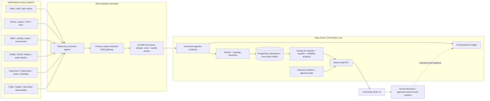

# Data Center Commander architecture

## Operating model

The platform is a data and workflow coordination layer. It receives observations
from approved systems, maps them to a time-versioned facility/asset/workload
graph, evaluates data quality and operational rules, and gives accountable
operators evidence-backed decisions. It does not replace domain authorities.



## Trust boundaries

1. **Enterprise/control networks to site DMZ:** outbound-only where possible;
   protocol translation and allowlists at a reviewed gateway. No general-purpose
   agent or message broker is placed on safety or control networks.
2. **Connector to ingestion:** connector identity is workload-bound; endpoints,
   read scopes, certificate/key references, rate budgets, and source version are
   operator-provisioned. Payload is treated as untrusted input.
3. **Ingestion to canonical records:** schema validation, tenant binding,
   identity mapping, dedupe, bounded payloads, timestamps/units, quality flags,
   provenance, and replay protection happen before data enters read models.
4. **Analytics to decision:** analytics are advisory, carry input lineage and
   uncertainty, and cannot create infrastructure commands. Critical operations
   remain owned by qualified human operators and existing control systems.
5. **Tenant to database:** every tenant row is RLS-scoped. Service roles use
   least privilege and transaction-local tenant context. Supabase deployments
   must separately prove Auth claims, RLS, grants, and service-role isolation.

## Bounded contexts

| Context | Owns | Does not own |
|---|---|---|
| Organization & estate | tenants, sites, campuses, rooms, racks, zones, asset graph | physical truth without a source observation |
| Telemetry & provenance | connector contracts, readings, quality, timestamps, calibration references | source device control |
| Energy & sustainability | boundaries, interval accounting, tariff/carbon factors, PUE/WUE and allocation | utility billing truth or carbon certification |
| Compute & service | clusters, hosts, accelerators, workloads, service objectives, placements | scheduler/hypervisor command authority |
| Capacity & resilience | usable capacity, reserves, dependencies, failure scenarios, forecasts | declaring untested redundancy safe |
| Maintenance & reliability | asset history, condition indicators, work orders, failure analysis | CMMS work execution or safety permit issuance |
| Operations & governance | incidents, changes, approvals, SOPs, evidence, handoffs | emergency command authority |
| Analytics & reporting | versioned metric definitions, quality coverage, decision records | unsourced or incomparable rankings |

## Data and event flow

`source envelope -> validated raw observation -> normalized measurement ->
asset/topology link -> quality decision -> derived metric -> operator review ->
work record -> observed outcome -> evidence closeout`.

Raw source facts are immutable or versioned; corrections append a superseding
record. Derived records name formula version, source IDs/time ranges, meter
boundary, allocation method, quality gates, and uncertainty. Event consumers
must be idempotent by `(tenant_id, source_id, source_event_id)` and tolerate
late, duplicated, out-of-order, and replayed messages.

## Scaling path

- Keep reference data relational and tenant-partitioned; index high-cardinality
  access by `(tenant_id, asset_id, metric_id, observed_at)`.
- Start with PostgreSQL and monthly partitioning when measured row volume merits
  it. Adopt TimescaleDB or a columnar lake only behind the same measurement and
  provenance contract, with retention/rollup policy and export verification.
- Separate hot raw telemetry, compacted hourly/daily rollups, and immutable
  evidence. Do not store full payload copies in every dashboard read model.
- Use bounded ingestion batches, per-source back-pressure, DLQ/quarantine,
  idempotency keys, cursor checkpoints, exponential retry with jitter, and
  circuit breakers. Surface lag and dropped/duplicate counts.
- Cache only versioned derived read models; invalidate by source watermark,
  formula version, asset-graph version, and tenant.
- Load-test representative intervals, asset counts, source fan-in, late events,
  tenant isolation, query concurrency, and recovery from backlog. Publish the
  test data shape, hardware, p95/p99, error budget, and correctness checks.

## Deployment shapes

Local single-node PostgreSQL is for engineering and synthetic demonstrations.
Site-edge collectors buffer during WAN loss; regional services aggregate
approved site data; a central control view joins regions only where residency
and tenant policy permit. A Supabase deployment is one managed Postgres/Auth/
Realtime/Storage option, not the architecture itself. Multi-site failure must
not disable local facility controls.

---

# Implementation

Everything below is read out of the source in `src/dcc/`, not out of intent. Line
references are to the current tree; commands shown are ones that were run against
this checkout.

## Two servers, only one of them documented

| | Served application | Legacy handler |
|---|---|---|
| Entry point | `dcc.api_async:app` (`src/dcc/api_async.py:313`) | `dcc.api.serve` (`src/dcc/api.py:653`) |
| Started by | `uvicorn`; `Dockerfile.async:21` | `scripts/run-local.py:6` (`from dcc.api import serve`); `Dockerfile:69` |
| Framework | FastAPI / Starlette / uvicorn | `http.server.ThreadingHTTPServer` |
| Routes | 27 under `/v2`, plus `/healthz`, `/readyz`, `/metrics`, `/`, `/assets`, `/docs`, `/redoc`, `/openapi.json` | `/v1/*`, `/healthz`, `/readyz`, `/`, `/v1/pricing/*` |
| Authentication | API key, enforced by default | none |
| Bind restriction | none (`uvicorn` binds whatever it is told) | refuses anything but loopback (`src/dcc/api.py:655`) |

`src/dcc/api.py` is a complete second HTTP surface that predates the FastAPI app. It is
still started by `scripts/run-local.py`, and its `/v1/*` routes work: with
`run-local.py` on port 8877, `GET /v1/facilities` returned `200` and
`GET /v2/overview` returned `404`. Against the FastAPI app the reverse holds
(`/v2/overview` `200`, `/v1/facilities` `404`). The README's API reference and route
tables describe the FastAPI app only.

`Dockerfile` runs `run-local.py --host 0.0.0.0`, which `api.py:655` rejects with
`ValueError: development API may bind only to loopback` — reproducible by running
`scripts/run-local.py --host 0.0.0.0`.

## Request path and middleware order

`add_middleware` inserts at the front of the stack, so the last registration is the
outermost layer. Measured order, outside in:

```
safety_contract        (src/dcc/api_async.py:1497)
  auth_middleware        (:542)   -> 401 / 403, sets request.state.tenant_id
    metrics_middleware   (:389)   -> latency, throughput, error counters
      rate_limit_middleware (:340) -> 429 token bucket, keyed on client host
        CORSMiddleware    (:320)  -> origins 127.0.0.1 and localhost only
          router -> handler -> get_pool() -> PostgreSQL
```

Read off the live application rather than assumed from source order:

```bash
PYTHONPATH=src .venv/bin/python -c "
from dcc.api_async import app
for i, m in enumerate(app.user_middleware):
    print(i, m.cls.__name__, getattr(m.kwargs.get('dispatch'), '__name__', None))"
```

```
0 BaseHTTPMiddleware safety_contract
1 BaseHTTPMiddleware auth_middleware
2 BaseHTTPMiddleware metrics_middleware
3 BaseHTTPMiddleware rate_limit_middleware
4 CORSMiddleware None
```

Because auth sits outside metrics, a rejected request is *not* counted, contrary to
the comment at `:545`. Measured: an unauthenticated `GET /v2/facilities` leaves
`api_requests_total{route="/v2/facilities"}` at 1, and the same call with a valid key
takes it to 2. A `401` also carries no `access-control-allow-origin` header, because
CORS is the innermost layer.

Static assets are mounted at `/assets` from `ui/` (`:333-336`), inside the auth
middleware: `/assets/topology.js` is `401` without a key and `200` with one. The
console shell injects `<meta name="dcc-api-key">` for loopback clients when
`DCC_UI_API_KEY` is set (`:2567-2573`), which is how the page can present a key that a
`<script src>` tag cannot.

## Why `src/dcc/pgcompat.py` exists

This is the most surprising thing in the codebase. Every query in `api_async.py` is
written in asyncpg style — `$1` placeholders, `conn.fetch(...)`, `conn.fetchrow(...)`
— but the pool is psycopg3 (`psycopg_pool.AsyncConnectionPool`, `:262-274`) and
asyncpg is not installed. The two APIs are incompatible:

| asyncpg | psycopg3 |
|---|---|
| `$1` placeholders | `%s` placeholders |
| `conn.fetch()` / `fetchrow()` | `cursor.execute()` then `fetchall()` |
| `$1` may be reused out of order | parameters bind strictly by occurrence |

As written, no query in the module can execute: psycopg3 reads `$1` as literal text,
and `AsyncConnection` has no `.fetch`. The adapter keeps the ~40 queries as written and
translates in one place:

- `translate()` (`pgcompat.py:45`) rewrites `$n` to `%s` **and reorders the arguments
  to order of first appearance**, so a query reusing `$1` still binds the right value.
  It doubles literal `%` so psycopg3 does not read it as a format specifier, and
  rejects a bare string as `params` because that would bind one character.
- `PgConnection` (`:73`) supplies `execute` / `fetch` / `fetchrow` / `fetchval` over a
  psycopg3 cursor; `execute` returns `rowcount`.
- `PgPool` (`:106`) and `_ConnectionCtx` (`:128`) wrap `pool.connection()` so that
  `async with pool.connection() as conn` yields a `PgConnection`.

`get_pool()` builds the real pool and then wraps it: `_pool = PgPool(_pool)`
(`:278-280`). The pool is `min_size=1, max_size=20, timeout=5`, with
`row_factory=dict_row` and `prepare_threshold=None` (`:265-274`).

## Tenant isolation

Tenant identity comes from the authenticated key, never from the request:

1. `auth_middleware` verifies the presented key (`X-API-Key` or
   `Authorization: Bearer`) at `:542`. Missing, invalid, expired and revoked all
   return `401`.
2. If the caller supplies `tenant_id` and it differs from the key's tenant, the
   middleware returns `403 tenant_mismatch` (`:579-590`).
3. It sets `request.state.tenant_id = api_key.tenant_id` (`:592`), which is what
   handlers use.
4. Each handler opens a transaction, marks it read-only, and binds the tenant for that
   transaction only (`:647-650`; 14 handlers do this):
   `SET TRANSACTION READ ONLY` and
   `SELECT set_config('dcc.tenant_id', $1, true)`. The `true` makes the setting
   transaction-local, so a pooled connection cannot leak one tenant's context into the
   next request.
5. Row-level security reads that setting. `database/schema.sql:342-350` loops over the
   tenant tables and executes, per table, `ENABLE ROW LEVEL SECURITY`,
   `FORCE ROW LEVEL SECURITY`, and a `tenant_scope` policy:

```sql
USING (tenant_id = nullif(current_setting('dcc.tenant_id', true), '')::uuid)
WITH CHECK (tenant_id = nullif(current_setting('dcc.tenant_id', true), '')::uuid)
```

`FORCE` is the part that matters: without it the table owner bypasses its own
policies, and the application connects as the owner. `scripts/verify-fresh-deploy.sh`
asserts `relrowsecurity AND relforcerowsecurity` on the tables 008 creates.

Public paths are only `/healthz`, `/readyz`, `/metrics`, `/openapi.json`, `/docs`,
`/docs/oauth2-redirect`, `/redoc` and `/` (`:509-516`). `DCC_ALLOW_ANONYMOUS=true`
short-circuits all of it (`:550`, through `dcc.security.posture.anonymous_allowed`,
`security/posture.py:34`). That flag removes the key check *and* the tenant binding,
which is why it is a development-only opt-out.

`DCC_API_KEYS` is parsed once at import into an in-memory `ApiKeyStore` (`:442-476`);
the format is comma-separated `<tenant-uuid>:<sha256-hex>`. Enforced auth with an empty
store is a lockout, so startup warns loudly or, with `DCC_REQUIRE_KEYS=true`, raises
(`:479-507`). The store is per-process: a runtime-minted key is invisible to sibling
workers, which is why the durable path is the environment variable.

## The advisory contract

`read_only: true` and `execution_permitted: false` are injected by `safety_contract`
(`:1497-1543`), not by handlers. It applies to `/v2` only, to `2xx` only, to
`application/json` only, and only when the decoded body is a dict, using `setdefault`
so a handler that sets the fields explicitly keeps its own value. Error bodies and list
bodies pass through untouched. Verified live: `/v2/facilities`, `/v2/costs` and
`/v2/evidence/verify` all return both fields.

The middleware exists because the guarantee used to be per-handler: `/v2/overview`
carried the fields, `/v2/facilities` did not. `healthz` also returns
`execution_permitted: false` and the `429` body carries it, but those are written by
the handlers, not by this middleware.

## Database access and failure modes

`get_pool()` (`:255`) is lazy and global. It raises `503 database_not_configured` when
`DCC_DATABASE_URL` is unset, `503 postgres_extra_required` when psycopg is missing, and
`503 database_unavailable` when the pool cannot open. `readyz` (`:609`) probes
`to_regclass('dcc.tenants')` and `to_regclass('dcc.assets')` inside a `READ ONLY`
transaction; it does not inspect RLS.

Caching is an in-process dict (`Cache`, `:195-217`) with `DCC_CACHE_TTL` (default 30s).
`DCC_REDIS_URL` is parsed into `Settings` (`:150`) but nothing consumes it — the process
never talks to Redis. `DCC_RATE_LIMIT_RPS` (default 100) drives a per-client token
bucket (`:224-246`), also per process, so limits are per worker and reset on restart.

There is no write SQL anywhere in `api_async.py`: no `INSERT`, `UPDATE` or `DELETE`
statement appears in the module. Every route is a read, a pure computation, or a cache
invalidation.

## What is reachable from the API

Importing the app loads exactly these `dcc` subpackages:

```bash
PYTHONPATH=src .venv/bin/python -c "
import sys, dcc.api_async
print(sorted({m.split('.')[1] for m in sys.modules if m.startswith('dcc.') and len(m.split('.'))>1}))"
```

```
['adapters', 'api_async', 'azure_prices', 'economics', 'google_prices', 'observability',
 'optimization_kernels', 'provenance', 'quality', 'security', 'validation']
```

`compliance` (`compliance.controls`, `compliance.scanner`) and `security_posture`
(`security_posture.scoring`) are imported lazily inside the governance handlers (`:904`,
`:1156`, `:1199`), so they are reachable without appearing in that list.

Several large subpackages are **not reachable** from the served API at all:

| Subpackage | Lines of Python | Reachable from `/v2` |
|---|---|---|
| `autoscaling` | 5,619 | no |
| `forecasting` | 4,769 | no (the forecast routes use the module's own code) |
| `network` | 4,564 | no |
| `dr` | 3,951 | no (the DR routes query `dcc.backup_policies` and `dcc.dr_*` tables directly) |
| `containers` (docker-swarm, openshift, rancher) | 3,665 | no |
| `operations` | 3,326 | no |
| `identity_federation` | 2,312 | no |
| `iac_observability` | 1,949 | no |
| `policy` | 1,647 | no |
| `cost_optimization` | 1,325 | no |
| `iac` | 1,018 | no |
| `soc` | 0 (only `__pycache__` remains) | no |

`adapters` (7,243 lines) is loaded only because `dcc.observability.health` imports
`dcc.adapters.registry` (`src/dcc/observability/health.py:20`); no `/v2` route calls an
adapter or contacts a vendor endpoint.

This is what makes the repository look much larger than the served surface: the API is
a read model over PostgreSQL plus a handful of pure functions (TCO, optimisation
kernels, schema and boundary validation). The domain libraries, the Terraform module
library and the test suite exist around it.

## Deliberate limits

- No route writes to a facility system, and none carries a breaker, setpoint, BMS
  write, VM lifecycle or workload-dispatch path. The POST routes compute
  recommendations, evaluate TCO, or clear the process cache.
- `/v2/cache/invalidate` (`:2240`) takes `pattern` as a query parameter on a POST and
  only clears the in-process cache.
- `compliance/scan` reports `configuration_gaps` for controls that read environment
  variables the served code never consults — `DCC_MFA_ENABLED`, `DCC_TLS_ENFORCED`, and
  the already-removed `DCC_AUTH_ENABLED` (`security/posture.py:6`,
  `compliance/controls.py:102`). A pass there means a setting is present, not that a
  behaviour was observed; `/v2/security/posture` is the endpoint that grades observed
  process state.
- Not verified here: behaviour under production load, a third-party penetration test,
  PostgreSQL 14 specifically (the local server is newer), and the Terraform modules.
  `python -m unittest discover -s tests -v` does not currently pass in full — failures
  are concentrated in `tests/terraform` and `tests/iac-*`, and `tests/e2e` errors on
  import because it needs the `e2e` extra (playwright).
